<h2>TensorFlow-FlexUNet-Image-Segmentation-Cervical-Spine-Fracture-Subset (2026/10/14)</h2>
Sarah T. Arai 
Software Laboratory antillia.com  

This is the first experiment of Image Segmentation for <b>Cervical Spine Fracture Subset</b>
 based on
our <a href="https://github.com/sarah-antillia/TensorFlow-FlexUNet-Image-Segmentation-Model">TensorFlowFlexUNet Model</a>
 (<b>TensorFlow Flexible UNet Image Segmentation Model for Multiclass</b>) and a 512x512-pixel PNG
 <a href="https://drive.google.com/file/d/1TDUzyOvsFTeW2OKaxk5-tDWVzQMUVsOW/view?usp=sharing">
Cervical-Spine-Fracture-ImageMask-Subset.zip</a> (<a href="https://creativecommons.org/publicdomain/zero/1.0/">CC0: Public Domain</a>
), 
which was derived by us from the Kaggle  
  
<a href="https://www.kaggle.com/datasets/akshat0912/png-data-for-cervical-spine-fracture-segmentation">
<b>PNG Data for Cervical Spine Fracture Segmentation</b>
</a> by Akshat Verma.
 

<b>Actual Image Segmentation for Cervical Spine Fracture Images of 512x512 pixels</b> 
As shown below, the inferred masks resemble the ground-truth masks.  
 
<table>
<tr>
<th width="320" height="auto">Input: image</th>
<th width="320" height="auto">Mask (ground_truth)</th>
<th width="320" height="auto">Prediction: inferred_mask</th>
</tr>
<tr>
<td>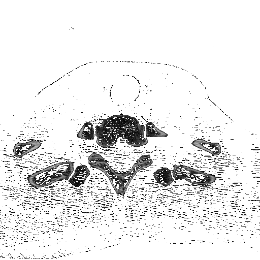</td>
<td></td>
<td></td>
</tr>
<tr>
<td>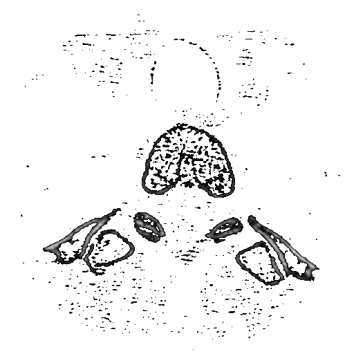</td>
<td>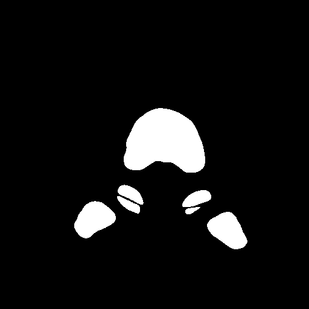</td>
<td>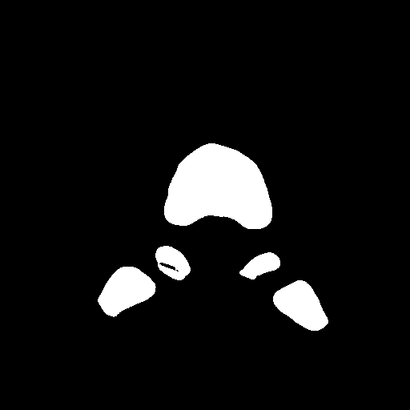</td>
</tr>
<tr>
<td>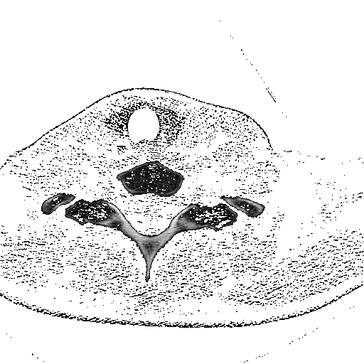</td>
<td></td>
<td></td>
</tr>
</table>

 
<h3>1. Dataset Citation</h3>
The dataset used here was derived from the following Kaggle:  
<a href="https://www.kaggle.com/datasets/akshat0912/png-data-for-cervical-spine-fracture-segmentation">
<b>PNG Data for Cervical Spine Fracture Segmentation</b>
</a> by Akshat Verma.
  
This PNG Dataset was derived from 
<a href="https://pubs.rsna.org/doi/10.1148/ryai.230034"><b>The RSNA Cervical Spine Fracture CT Dataset</b></a>
  
For more information, please refer to the Kaggle website  
<a href="https://www.kaggle.com/competitions/rsna-2022-cervical-spine-fracture-detection/">
<b>RSNA 2022 Cervical Spine Fracture Detection</b></a>
  
<b>Context</b> 
RSNA has teamed with the American Society of Neuroradiology (ASNR) and the American Society of 
Spine Radiology
 (ASSR) to conduct an AI challenge competition exploring whether artificial intelligence can be used to aid 
 in the detection and localization of cervical spine fractures.
  
To create the ground truth dataset, the challenge planning task force collected imaging data sourced from 
twelve sites on six continents, including approximately 3,000 CT studies. Spine radiology specialists 
from the ASNR and ASSR provided expert image level annotations these studies to indicate the presence, 
vertebral level and location of any cervical spine fractures.
  
In this challenge competition, you will try to develop machine learning models that match the radiologists' 
performance in detecting and localizing fractures to the seven vertebrae that comprise the cervical spine. 
Winners will be recognized at an event during the RSNA 2022 annual meeting.
  
<b>License</b> 
<a href="https://creativecommons.org/publicdomain/zero/1.0/">CC0: Public Domain</a>
 
 
<h3>
2 Cervical-Spine-Fracture-Subset Ultrasound ImageMask Dataset
</h3>
<h3>2.1 Download ImageMask Dataset</h3>
 If you would like to train this Cervical-Spine-Fracture-Subset Segmentation model,
 please download the dataset from Google Drive  
 <a href="https://drive.google.com/file/d/1TDUzyOvsFTeW2OKaxk5-tDWVzQMUVsOW/view?usp=sharing">
Cervical-Spine-Fracture-Subset-ImageMask-Subset.zip</a>. 
Expand the downloaded ImageMaskDataset and put it under the <b>./dataset</b> folder.
 
<pre>
./dataset
└─Cervical-Spine-Fracture-Subset
    ├─test
    │   ├─images
    │   └─masks
    ├─train
    │   ├─images
    │   └─masks
    └─valid
         ├─images
         └─masks
</pre>
 
<b>Cervical-Spine-Fracture-Subset Statistics</b> 
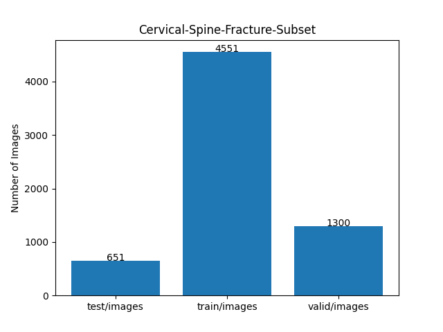 
 
As shown above, the number of images in the training and valid datasets is large enough to use for the
 training set of our segmentation model.
 
<h3>2.2 Derivation of ImageMask Dataset</h3>
The folder structure of the original dataset <a href="https://www.kaggle.com/datasets/akshat0912/png-data-for-cervical-spine-fracture-segmentation">
<b>PNG Data for Cervical Spine Fracture Segmentation</b>
</a> is as follows.
<pre>
./Cervical_Spine_Fracture
 ├─test_png
 │   ├─images ( 5,663 files)
 │   │
 │   └─mask   ( 5,663 files)
 │ 
 └─train_png   
      ├─images (24,169 files)
      │
      └─masks  (24,169 files)
</pre>
In this experiment, we generated a one-third subset of the  <b>train_png</b> for simplicity.  
 
<h3>2.3 Train Sample Images and Masks</h3>
<b>Train_sample_images</b> 
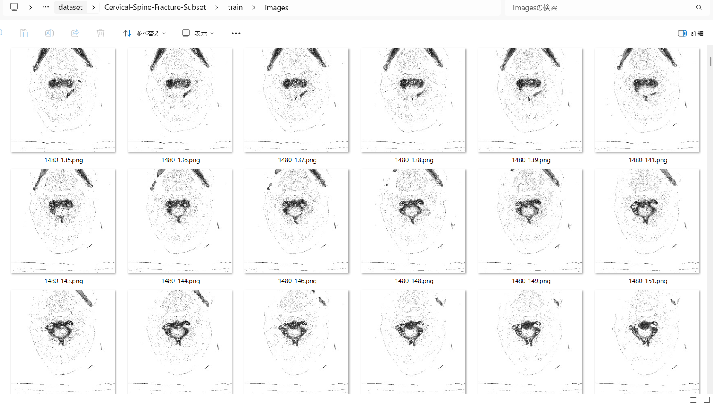
 
<b>Train_sample_masks</b> 
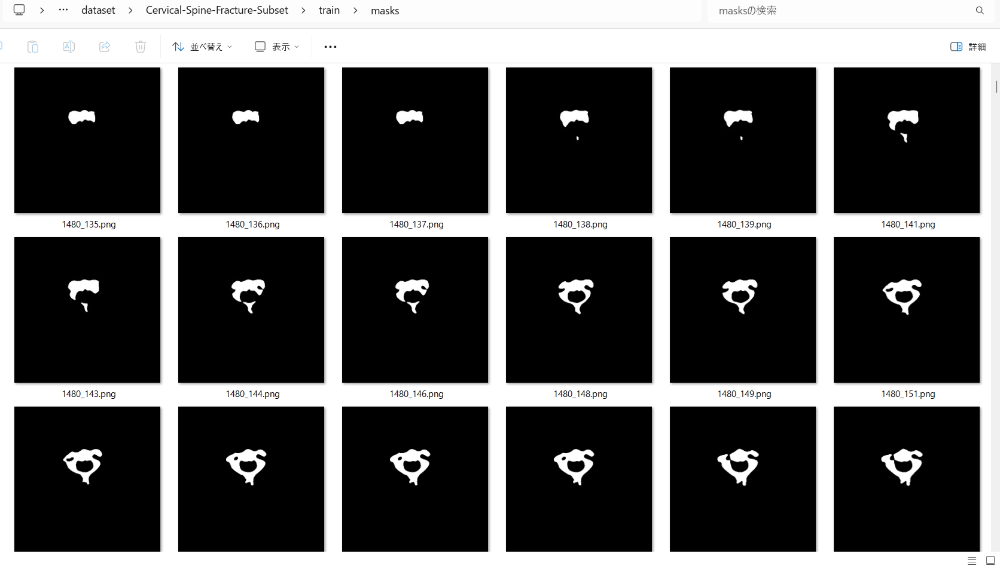
 

<h3>
3 Train TensorFlowFlexUNet Model
</h3>
 We trained the Cervical-Spine-Fracture-Subset TensorFlowFlexUNet model using the following
<a href="./projects/TensorFlowFlexUNet/Cervical-Spine-Fracture-Subset/train_eval_infer.config"> <b>train_eval_infer.config</b></a> file.  
Please move to ./projects/TensorFlowFlexUNet/Cervical-Spine-Fracture-Subset and run the following bat file. 
<pre>
>1.train.bat
</pre>
This runs the following command. 
<pre>
>python ../../../src/TensorFlowFlexUNetTrainer.py ./train_eval_infer.config
</pre>

<b>Model parameters</b> 
Defined a small <b>base_filters=16 </b> and large <b>base_kernels=(11,11)</b> for the first Conv Layer of Encoder Block of 
<a href="./src/TensorFlowFlexUNet.py">TensorFlowFlexUNet.py</a> 
and a large <b>num_layers=8</b> (including a bridge between Encoder and Decoder Blocks).
<pre>
[model]
; You may specify your own UNet class derived from our TensorFlowFlexModel
model         = "TensorFlowFlexUNet"
generator     =  False
image_width    = 512
image_height   = 512
image_channels = 3
num_classes    = 2
base_filters   = 16
base_kernels   = (11,11)
num_layers     = 8
dropout_rate   = 0.04
dilation       = (1,1)
</pre>
<b>Learning rate</b> 
Defined a small learning rate.  
<pre>
[model]
learning_rate  = 0.00007
</pre>
<b>Loss and metrics functions</b> 
Specified "categorical_focal_dice_loss" and <a href="./src/dice_coef_multiclass.py">"dice_coef_hybrid"</a>. 
<pre>
[model]
loss           = "categorical_focal_dice_loss"
metrics        = ["dice_coef_hybrid"]
hybrid_alpha   = 1.6
hybrid_beta    = 0.4
</pre>
<b>Dataset class</b> 
Specifed <a href="./src/ImageCategorizedMaskDataset.py">ImageCategorizedMaskDataset</a> class. 
<pre>
[dataset]
class_name    = "ImageCategorizedMaskDataset"
</pre>
 
<b>Learning rate reducer callback</b> 
Enabled the learning_rate_reducer callback and a small reducer_patience.
<pre> 
[train]
learning_rate_reducer = True
reducer_factor     = 0.4
reducer_patience   = 4
</pre>
<b>Early stopping callback</b> 
Enabled early stopping callback with the patience parameter.
<pre>
[train]
patience      = 10
</pre>

<b>RGB Color map</b> 
Specified RGB color map dict for Cervical-Spine-Fracture-Subset 2 classes. 
<pre>
[mask]
mask_datatype= "categorized"
mask_file_format = ".png"
; Cervical-Spine-Fracture-Subset RGB color map dict for 1+1 classes.
;      Background: black, Fracture: white
rgb_map = {(0,0,0):0,(255,255,255):1,}

</pre>

<b>Epoch change inference callback</b> 
Enabled <a href="./src/EpochChangeInferencer.py">epoch_change_infer callback</a></b>. 
<pre>
[train]
epoch_change_infer       = True
epoch_change_infer_dir   =  "./epoch_change_infer"
num_infer_images         = 6
</pre>

By using this callback, on every epoch change, the inference procedure can be called
 for 6 images in the <b>mini_test</b> folder. This will help you confirm how the predicted mask changes 
 at each epoch during your training process.  
  
As shown below, early in the model training, the predicted masks from our FlexUNet segmentation model showed 
discouraging results.
 However, as training progressed through the epochs, the predictions gradually improved. 
   
 
<b>Epoch_change_inference output at starting (epoch 1,2,3)</b> 
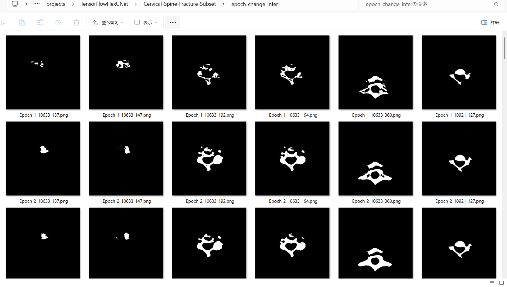 
 
<b>Epoch_change_inference output at middlepoint (epoch 14,15,16)</b> 
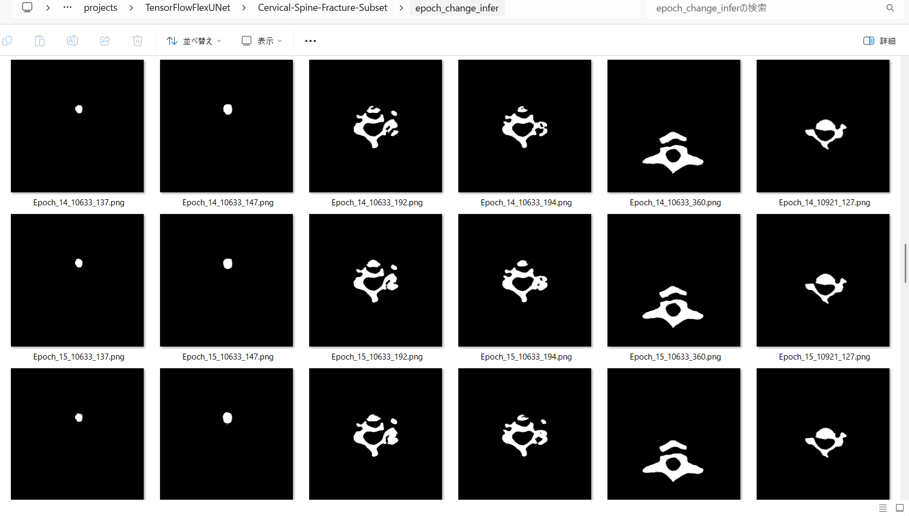 
 
<b>Epoch_change_inference output at ending (epoch 29,30,31)</b> 
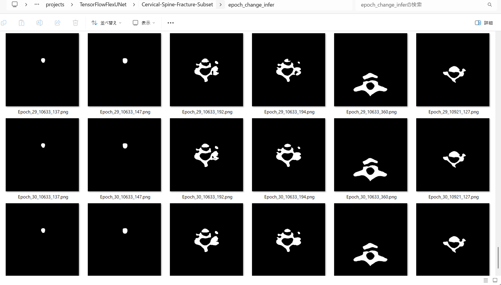 
 
In this experiment, the training process was stopped at epoch 31 by EarlyStoppingCallback. 
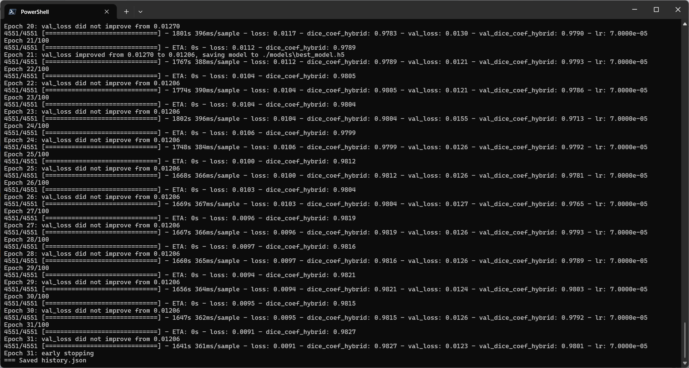 
 
<a href="./projects/TensorFlowFlexUNet/Cervical-Spine-Fracture-Subset/eval/train_metrics.csv">train_metrics.csv</a> 
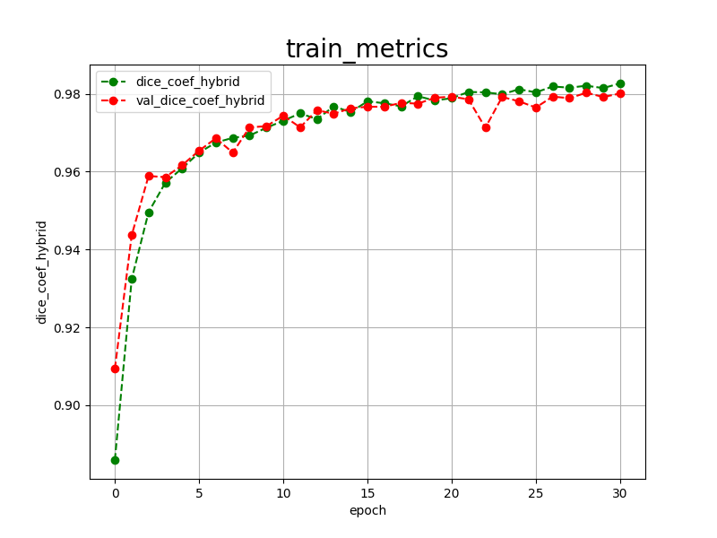 
 
<a href="./projects/TensorFlowFlexUNet/Cervical-Spine-Fracture-Subset/eval/train_losses.csv">train_losses.csv</a> 
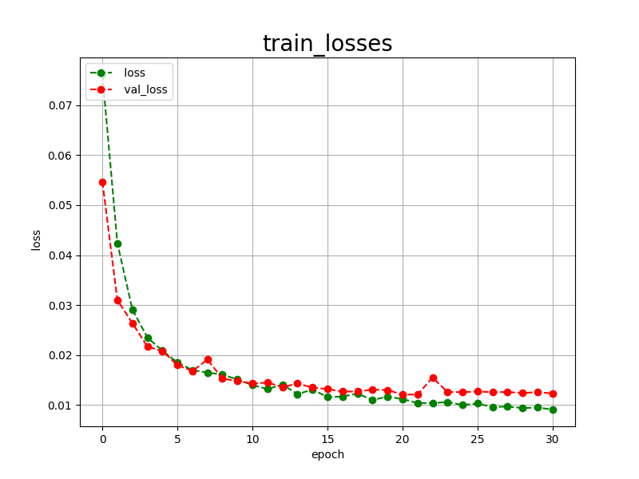 
 
<h3>
4 Evaluation
</h3>
Please move to <b>./projects/TensorFlowFlexUNet/Cervical-Spine-Fracture-Subset</b> folder, 
and run the following bat file to evaluate the TensorFlowUNet model for Cervical-Spine-Fracture-Subset. 
<pre>
./2.evaluate.bat
</pre>
This runs the following command.
<pre>
python ../../../src/TensorFlowFlexUNetEvaluator.py ./train_eval_infer.config
</pre>

Evaluation console output: 
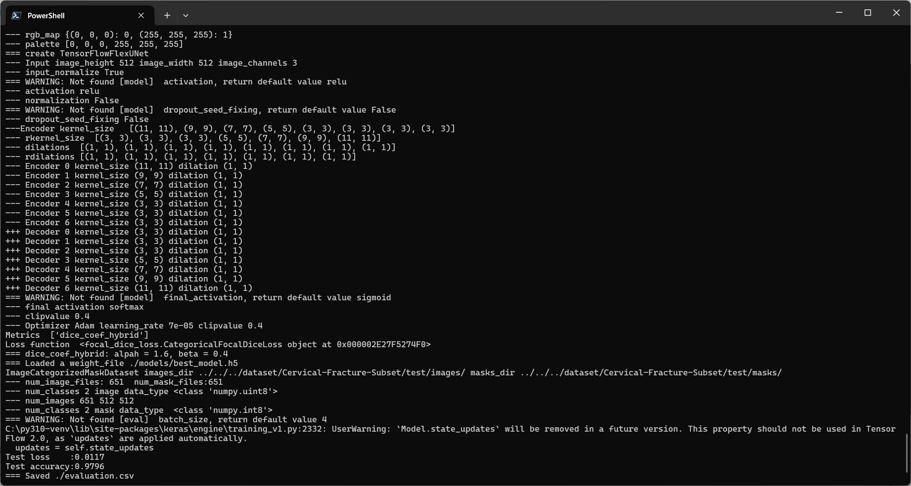
  Image-Segmentation-Cervical-Spine-Fracture-Subset

<a href="./projects/TensorFlowFlexUNet/Cervical-Spine-Fracture-Subset/evaluation.csv">evaluation.csv</a> 
The loss (categorical_focal_dice_loss) on this Cervical-Spine-Fracture-Subset/test was low, and dice_coef_hybrid was high, as shown below.
 
<pre>
categorical_focal_dice_loss,0.0117
dice_coef_hybrid,0.9796
</pre>
 

<h3>
5 Inference
</h3>
Please move to <b>./projects/TensorFlowFlexUNet/Cervical-Spine-Fracture-Subset</b> folder
and run the following bat file to infer segmentation regions for images using the trained TensorFlowUNet model for Cervical-Spine-Fracture-Subset. 
<pre>
./3.infer.bat
</pre>
This runs the following command.
<pre>
python ../../../src/TensorFlowFlexUNetInferencer.py ./train_eval_infer.config
</pre>

<b>mini_test_images</b> 
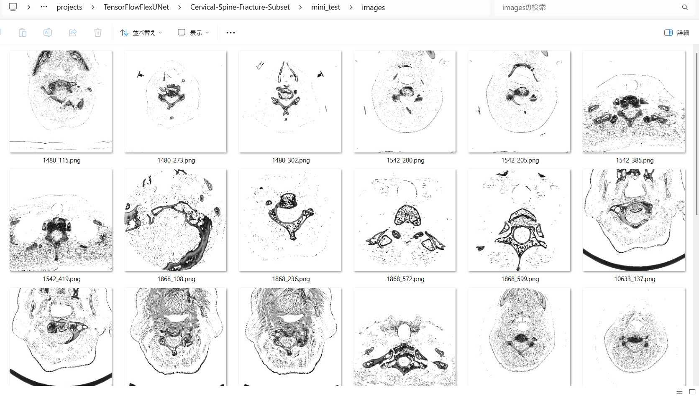 
<b>mini_test_mask(ground_truth)</b> 
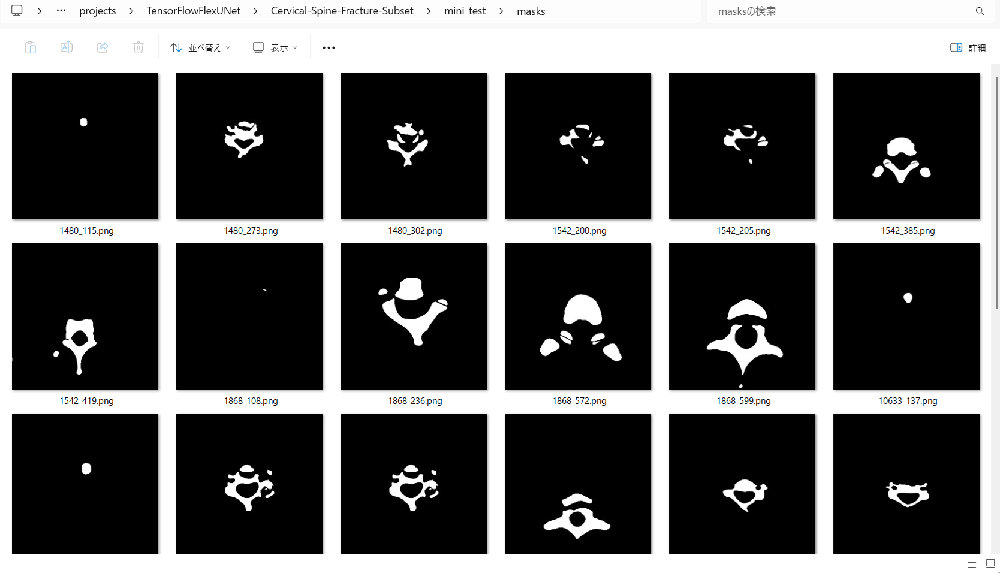 

<b>Inferred test masks</b> 
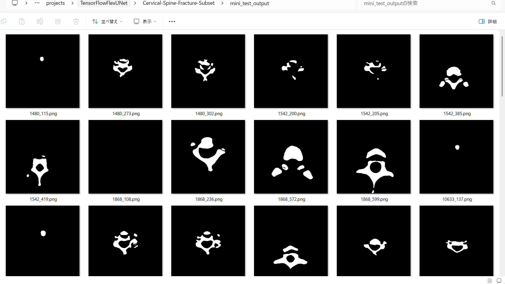 
 

<b>Enlarged images and masks for Cervical-Spine-Fracture-Subset MRI Images of 512x512 pixels</b> 
As shown below, the inferred masks look similar to the ground truth masks. 
 
<table>
<tr>
<th width="320" height="auto">Image</th>
<th width="320" height="auto">Mask (ground_truth)</th>
<th width="320" height="auto">Inferred-mask</th>
</tr>
<tr>
<td>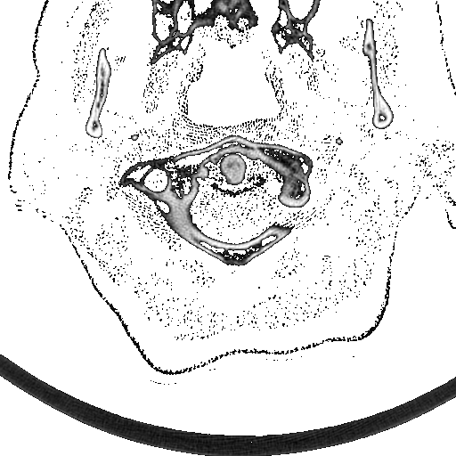</td>
<td></td>
<td></td>
</tr>
<tr>
<td>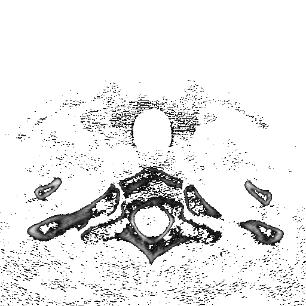</td>
<td></td>
<td></td>
</tr>
<tr>
<td>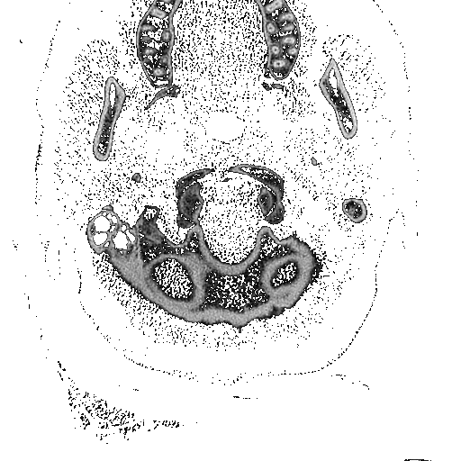</td>
<td></td>
<td>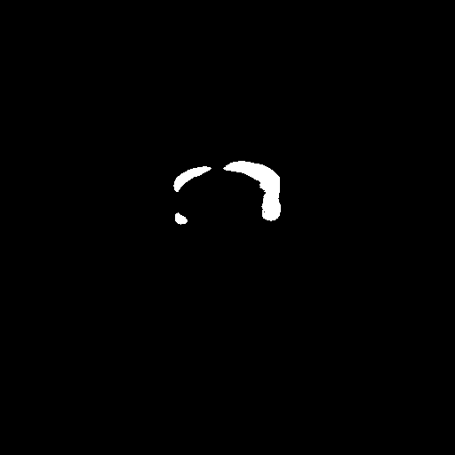</td>
</tr>
<tr>
<td>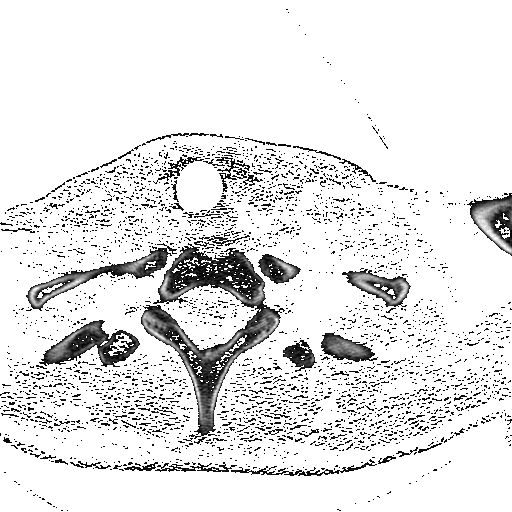</td>
<td></td>
<td></td>
</tr>
<tr>
<td>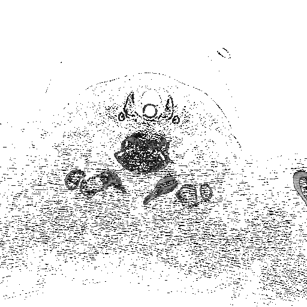</td>
<td>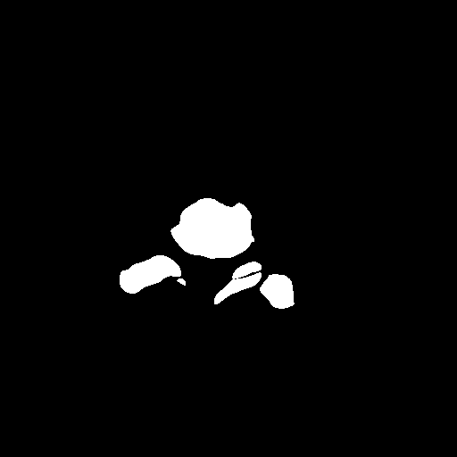</td>
<td></td>
</tr>
<tr>
<td>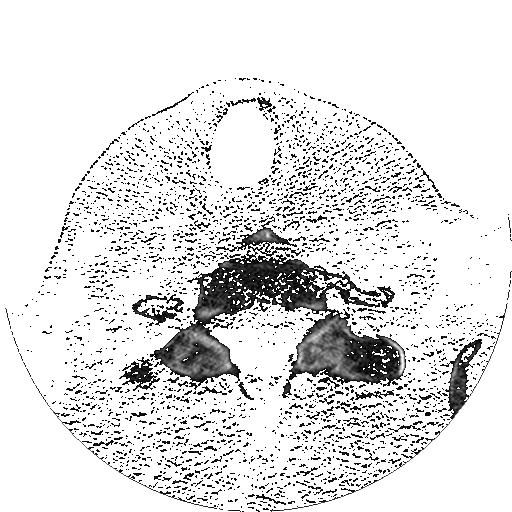</td>
<td></td>
<td></td>
</tr>
</table>

 
<h3>
References
</h3>
<b>1. Automated Multi-Task Deep Learning Framework for Cervical Spine Fracture Segmentation</b> 
Shengjie Gou, Anlin Luo, Yingping Li 
<a href="https://dl.acm.org/doi/epdf/10.1145/3784929.3784933">https://dl.acm.org/doi/epdf/10.1145/3784929.3784933</a>
  
<b>2. An efficient deep learning based approach for automated 
identification of cervical vertebrae fracture as a clinical support aid</b> 
Singh, M., Tripathi, U., Patel, K.K. et al. 
<a href="https://www.nature.com/articles/s41598-025-10448-6">https://www.nature.com/articles/s41598-025-10448-6</a>
  
<b>3. 3D Cervical Spine Segmentation and Multi-Vertebrae Fracture Detection</b> 
Swayam 
<a href="https://github.com/SwayamInSync/3D-Cervical-Spine-Segmentation-and-Multi-Vertebrae-Fracture-Detection">
https://github.com/SwayamInSync/3D-Cervical-Spine-Segmentation-and-Multi-Vertebrae-Fracture-Detection</a>
  
<b>4. TensorFlow-FlexUNet-Image-Segmentation-Bladder-Cancer-MRI-New-Dice-Metric</b> 
Toshiyuki Arai 
<a href="https://github.com/sarah-antillia/TensorFlow-FlexUNet-Image-Segmentation-Bladder-Cancer-MRI-New-Dice-Metric">
https://github.com/sarah-antillia/TensorFlow-FlexUNet-Image-Segmentation-Bladder-Cancer-MRI-New-Dice-Metric</a>
  
<b>5. TensorFlow-FlexUNet-Image-Segmentation-Model</b> 
Toshiyuki Arai 
<a href="https://github.com/sarah-antillia/TensorFlow-FlexUNet-Image-Segmentation-Model">
https://github.com/sarah-antillia/TensorFlow-FlexUNet-Image-Segmentation-Model
</a>
  
